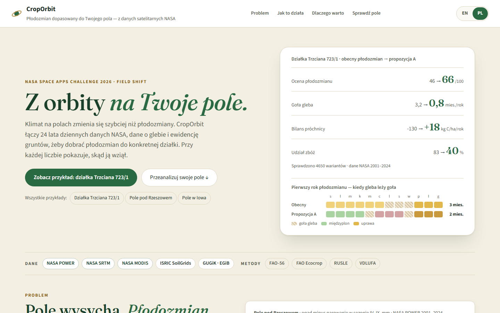
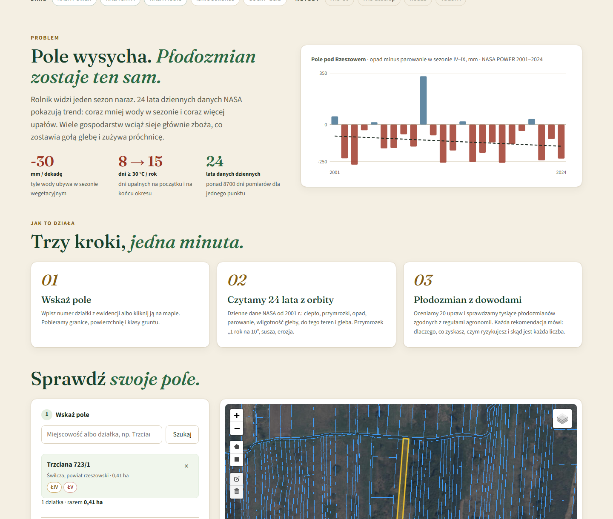
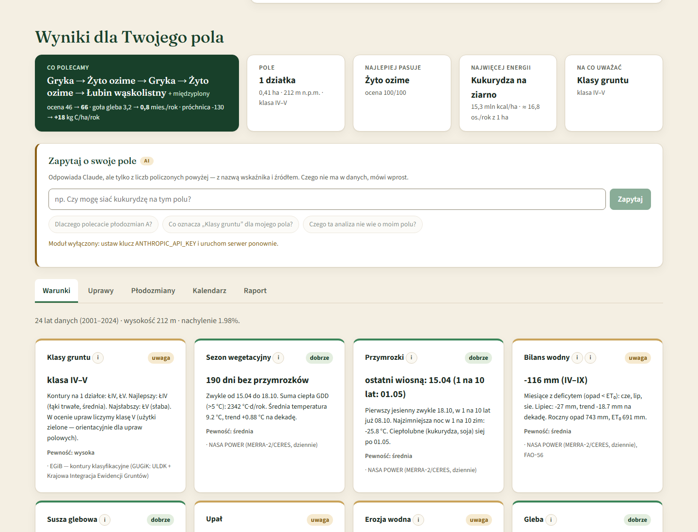
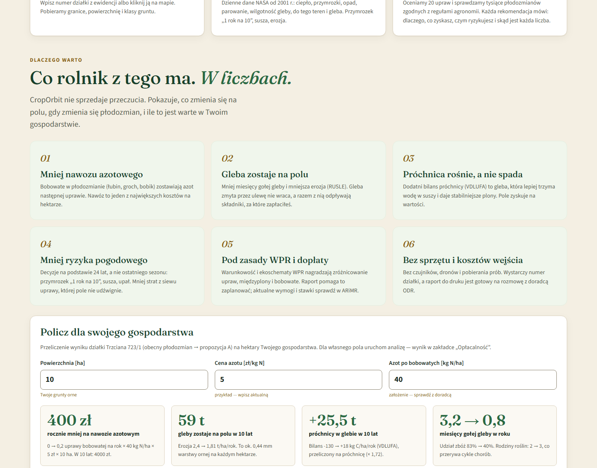
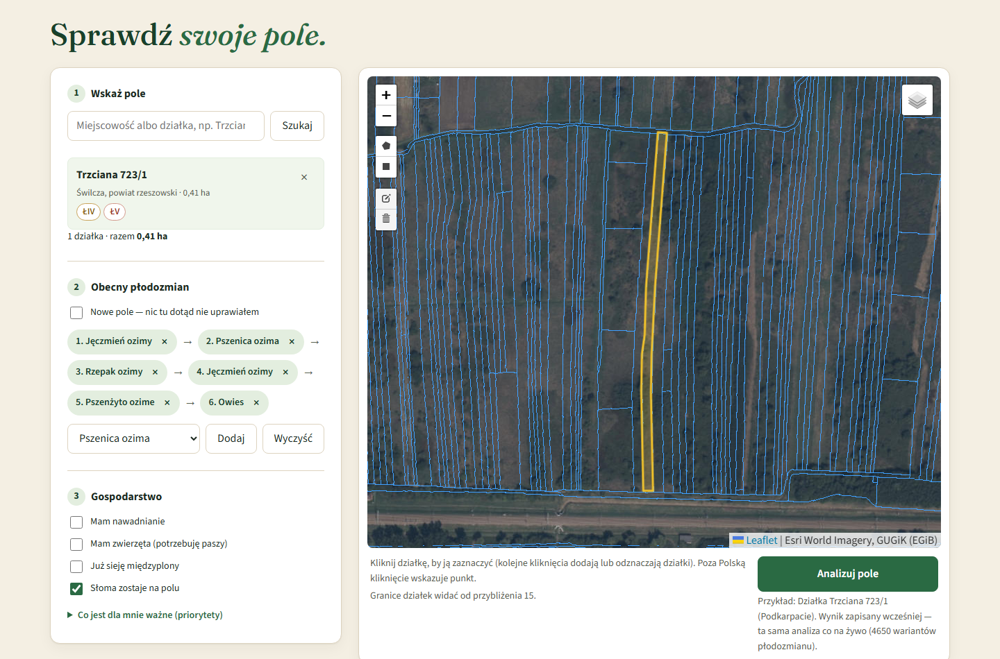

# CropOrbit — z orbity na Twoje pole

**Płodozmian dopasowany do konkretnej działki, z 24 lat dziennych danych NASA.**
NASA Space Apps Challenge 2026, Rzeszów · wyzwanie *Field Shift: Adapting Farms with NASA Data* · zespół RPCAM

**[▶ Otwórz demo: wynik dla działki Trzciana 723/1](https://kam-boc112.github.io/CropOrbit/?demo=trzciana&lang=pl)** ·
[wersja angielska](https://kam-boc112.github.io/CropOrbit/?demo=trzciana&lang=en)



## Problem

Klimat na polach zmienia się szybciej, niż zmieniają się płodozmiany. Na działce pod Rzeszowem dane NASA z lat 2001–2024
pokazują, że bilans wodny sezonu spada o ok. **30 mm na dekadę**, a dni upalnych przybywa. Mimo to wiele gospodarstw
sieje od lat głównie zboża. Rolnik nie ma prostego narzędzia, które powie: *co siać na tej działce w kolejnych latach,
żeby chronić glebę i wodę, przy warunkach, jakie naprawdę panują na moim polu?*



## Co robi CropOrbit

Rolnik wpisuje numer działki (albo klika ją na mapie) i podaje, co uprawiał. Aplikacja:

1. pobiera **24 lata dziennych danych NASA POWER**, ukształtowanie terenu (**NASA SRTM**), zieleń pola z satelity
   (**NASA MODIS NDVI**), glebę (**ISRIC SoilGrids**) i **klasę gruntu z urzędowej ewidencji (GUGiK)**;
2. ocenia **20 upraw** w skali 0–100 metodą prawa minimum (FAO Ecocrop / GAEZ);
3. sprawdza **tysiące wariantów płodozmianu** zgodnych z regułami agronomicznymi i porównuje obecny płodozmian
   z 3 najlepszymi alternatywami na 7 osiach: woda, gleba, erozja, azot, choroby, dochód, pasza;
4. przy każdej liczbie podaje **źródło i poziom pewności**, wypisuje **luki w danych** i rzeczy do sprawdzenia z doradcą;
5. **„Zapytaj o swoje pole”** — pytanie zwykłymi słowami, odpowiedź Claude oparta **wyłącznie na policzonych liczbach**
   (moduł opcjonalny, wymaga klucza API).

### Wynik dla działki Trzciana 723/1 (0,41 ha, klasa IV–V)

| | Obecny płodozmian | Propozycja A: gryka → żyto → gryka → żyto → łubin + międzyplony |
|---|---|---|
| Ocena łączna | 46 | **66** |
| Goła gleba | 3,2 mies./rok | **0,8 mies./rok** |
| Erozja wodna | 2,4 t/ha/rok | **1,81 t/ha/rok** |
| Bilans próchnicy | −130 kg C/ha/rok | **+18 kg C/ha/rok** |
| Udział zbóż | 83% | **40%** |
| Deficyt wody upraw | 5 mm | 16 mm — kompromis, który aplikacja pokazuje obok zysków |

Sprawdzono 4650 wariantów płodozmianu. Najlepiej pasują: żyto ozime 100/100, łubin wąskolistny 97, gryka 86.



## Dlaczego to się rolnikowi opłaca

Sekcja „Dlaczego warto” na stronie i zakładka **Opłacalność** w wynikach przeliczają analizę na korzyści gospodarstwa.
Liczby pola (bobowate w płodozmianie, erozja, próchnica, goła gleba) pochodzą z analizy; cenę azotu i azot zostawiany
przez bobowate rolnik wpisuje sam. Dla 10 ha i przykładowych założeń (5 zł/kg N, 40 kg N/ha) zmiana płodozmianu
na działce Trzciana 723/1 daje ok. **400 zł rocznie mniej na nawozie**, **59 t gleby zatrzymanej na polu** i
**+25 t próchnicy w 10 lat**. Obok korzyści aplikacja pokazuje koszty: wyższy deficyt wody upraw i nowe rynki zbytu.





## Jak uruchomić

Wystarczy Python ≥ 3.9 — **bez instalowania pakietów**.

```bash
python server.py            # http://localhost:8000
```

- Pola przykładowe otwierają się od ręki (gotowe wyniki w `static/demo/`, odświeżane poleceniem `python server.py --snapshot`).
- Pierwsza analiza nowego pola trwa 30–50 s (pobieranie 24 lat danych), kolejne poniżej 1 s (cache na dysku).
- Moduł AI: `pip install -r requirements.txt` i zmienna `ANTHROPIC_API_KEY`. Bez niej reszta aplikacji działa normalnie.

**Hosting bez serwera:** na GitHub Pages (`.github/workflows/pages.yml`) ten sam kod Pythona działa w przeglądarce —
w Pyodide (WebAssembly) w Web Workerze (`static/engine.js`). Dane pobiera prosto z NASA POWER, SoilGrids, GUGiK
i Open-Meteo (teren: Copernicus DEM 90 m, bo OpenTopoData nie przyjmuje zapytań ze stron). Pomija tylko profil NDVI
i moduł AI. Pełna wersja z serwerem: Render (`render.yaml`) albo GitHub Codespaces (`.devcontainer/`).

## Jak to zbudowaliśmy

- **Serwer:** Python, tylko biblioteka standardowa: pobieranie danych, wskaźniki agroklimatyczne, baza 20 upraw,
  generator płodozmianów, działki i klasy gruntu, dwujęzyczność (PL/EN).
- **Przeglądarka:** HTML, CSS i JavaScript bez frameworka, mapa Leaflet z warstwą działek GUGiK, wykresy Chart.js.
  Dostępność WCAG 2.1 AA (kontrast, klawiatura, czytniki ekranu), działa na telefonie.
- **Metody:** FAO‑56 Penman‑Monteith (parowanie), FAO Ecocrop/GAEZ (przydatność upraw), RUSLE (erozja),
  VDLUFA (bilans próchnicy), percentyle i trendy (przymrozek „1 rok na 10”, zmiany na dekadę).
- **AI w produkcie:** Claude (`claude-opus-5-5`) odpowiada na pytania rolnika wyłącznie z wyniku analizy; czego nie ma
  w danych — mówi wprost. Wszystkie pozostałe teksty to szablony wypełniane wyliczonymi liczbami.
- **AI w pracy zespołu:** kod pisaliśmy z asystentem AI (Claude Code): od pobierania danych przez analizę i interfejs
  po przegląd dostępności i wydajności. Ludzie decydowali o metodach, regułach agronomicznych i sprawdzali wyniki.

## Ograniczenia (mówimy o nich otwarcie)

- Klimat z NASA POWER ma rozdzielczość ok. 50 km (z korektą wysokości), bez lokalnych mrozowisk i gradobić.
- Wilgotność gleby to model MERRA‑2, nie pomiar; SoilGrids to model 250 m — zalecana analiza gleby.
- Oś „Dochód” to indeks względny: brak lokalnych cen, plonów, danych o chorobach i szkodnikach.
- Klasy gruntu i granice działek tylko w Polsce; poza Polską analiza działa dla punktu na mapie.

## Co dalej

NASA SMAP (satelitarna wilgotność gleby), GPM IMERG (natężenie opadów do erozji), ECOSTRESS (stres cieplny 70 m),
lokalne plony i ceny (GUS, MRiRW), kalibracja wymagań upraw z doradcami ODR.

## Zespół RPCAM

Kamil Bochnowski · Dominik Pruchnik · Karolina Furmanek · Martyna Mróz · Hubert Zając

*Narzędzie wspiera, a nie zastępuje rolnika i doradcę rolniczego.*
